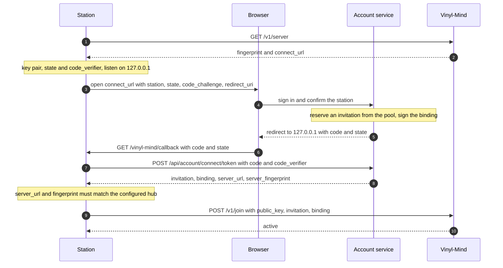
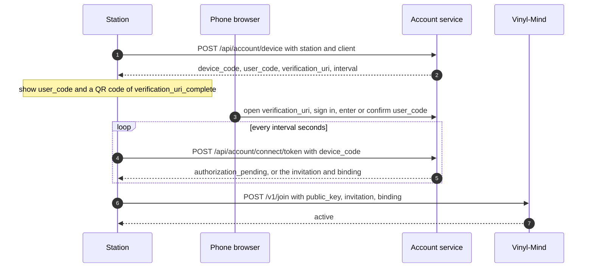

# Connecting a station by signing in

How a station joins a hub through an account on a website, the way desktop apps connect to an online account: the
user clicks *Connect*, signs in in the browser, confirms, and the station is connected. This page is the contract
between three parts:

| Part | Role here |
|---|---|
| **Station** (vinyl-check, client `vinyl-check/1.1.0` and later) | starts the flow, proves it started it (PKCE), exchanges the result for an invitation, joins the hub |
| **Account service** (on the vinyl-check website) | accounts, sign-in, the consent pages, hands out invitations from a pool, signs a **binding** of the invitation to the station's key |
| **Hub** (Vinyl-Mind) | unchanged way of joining (`POST /v1/join` with an invitation), plus checking the binding |

The hub gets **no new endpoint and no outgoing connection**. Everything that changes it stays a command on its host
or a station's own signed request. A hub without accounts (self-hosted) simply has no `connect_url`, and stations
join with an invitation code as before.

Standards: OAuth 2.0 authorization code with PKCE for native apps (RFC 6749, RFC 7636, RFC 8252), device
authorization grant (RFC 8628), JWS compact serialisation with EdDSA (RFC 7515, RFC 8037).

## Discovery

The station's default server is `https://api.vinylcheck.net` (one place in the station's code, overridable in its
configuration). `GET /v1/server` names the account service when the hub has one:

```json
{"fingerprint": "SHA256:…", "connect_url": "https://vinylcheck.net/account/connect/", "…": "…"}
```

Without `connect_url`, the station offers only *Join with an invitation code*.

## Flow A: browser on the same computer



1. The station has (or creates) its Ed25519 key pair for this hub (`spec/signing.md`). It creates `state` (16 random
   bytes, base64url) and `code_verifier` (32 random bytes, base64url), and `code_challenge =
   base64url(SHA-256(code_verifier))`. It listens on `127.0.0.1` (or `[::1]`) on a free port.
2. It opens the system browser at `connect_url` with these query parameters (all URL-encoded; the fingerprint
   contains `+` and `/`):

   | Parameter | Value |
   |---|---|
   | `response_type` | `code` |
   | `client_id` | the client name, `vinyl-check` |
   | `client` | name and version, `vinyl-check/1.1.0` |
   | `redirect_uri` | `http://127.0.0.1:<port>/vinyl-mind/callback` or `http://[::1]:<port>/vinyl-mind/callback` |
   | `state` | as created |
   | `code_challenge` | as computed |
   | `code_challenge_method` | `S256` (the only method accepted) |
   | `station` | the station key's fingerprint, `SHA256:…` |

3. The account service checks the request: `redirect_uri` is http on a loopback address (`127.0.0.0/8`, `::1`,
   `localhost`) with the path `/vinyl-mind/callback`, any port, no user info, no fragment; anything else is refused
   with an error page and **never redirected to**. The user signs in; confirming needs a fresh sign-in (password
   entered within the last 10 minutes). The page shows the station's fingerprint in short form and the client.
4. On confirmation the account service reserves an invitation from its pool, signs a binding (below), and redirects
   to `redirect_uri` with `code` (a one-time code: 8 characters Crockford base32, valid **60 seconds**, one use,
   bound to `client_id`, `redirect_uri`, `code_challenge` and `station`) and `state`. If the user declines:
   `error=access_denied&state=…`.
5. The station's callback accepts only the `state` of a flow it started and only while that flow is open, then shows
   a small page "Connected – you can close this tab".
6. Token exchange, see below, with `grant_type=authorization_code`.
7. Join, see below.

If no callback arrives (a firewall, a browser on another machine), the station switches to flow B. There is no code
for the user to copy from the website to the station.

## Flow B: no browser on the device (a Raspberry Pi used from a phone)



`POST <account service>/api/account/device` with `{"station": "SHA256:…", "client": "vinyl-check/1.1.0"}` answers

```json
{"device_code": "…", "user_code": "KXQR-7MPD", "verification_uri": "https://vinylcheck.net/account/activate/",
 "verification_uri_complete": "https://vinylcheck.net/account/activate/?code=KXQR-7MPD", "interval": 5,
 "expires_in": 600}
```

`user_code` is 8 characters Crockford base32, case and hyphen ignored. The station shows it with
`verification_uri` and a QR code of `verification_uri_complete`, then polls the token endpoint every `interval`
seconds with `grant_type=urn:ietf:params:oauth:grant-type:device_code`.

## Token endpoint

`POST <account service>/api/account/connect/token`, JSON:

| Grant | Body |
|---|---|
| flow A | `{"grant_type": "authorization_code", "code", "code_verifier", "redirect_uri", "client_id", "station"}` |
| flow B | `{"grant_type": "urn:ietf:params:oauth:grant-type:device_code", "device_code", "client_id", "station"}` |

Success, `200`, with `Cache-Control: no-store`:

```json
{"invitation": "…", "binding": "<JWS>", "server_url": "https://api.vinylcheck.net",
 "server_fingerprint": "SHA256:p7xkFojVrEYTqJM6C12dyCh0SJAlxg+wN8VUSSa2auo"}
```

The invitation is a secret: delivered once, never logged by the account service or the station, never put into a
URL. The station checks that `server_url` is its configured hub and `server_fingerprint` the key it accepted from
`GET /v1/server`, and stops otherwise.

Errors, as in OAuth (`{"error": "…", "error_description": "…"}`):

| Status | `error` | Meaning, and what the station does |
|---|---|---|
| 400 | `invalid_request` | a field is missing or malformed: a bug |
| 400 | `invalid_grant` | code unknown, expired, used, wrong verifier, other `redirect_uri`, `client_id` or `station`: start again |
| 400 | `access_denied` | the user declined: stop |
| 400 | `authorization_pending` | flow B: not confirmed yet, keep polling |
| 400 | `slow_down` | flow B: poll 5 seconds less often from now on |
| 400 | `expired_token` | flow B: the device code expired, start again |
| 429 | `rate_limited` | wait as `Retry-After` says |

After five failed exchanges a code is burned.

## The binding

The account service signs, for every invitation it hands out, which station key may use it. Format: a JWS in compact
serialisation, as for models (`spec/signing.md`):

```
base64url(header) . base64url(payload) . base64url(Ed25519 signature over "header.payload")
```

- header: `{"alg": "EdDSA", "typ": "vinyl-mind-binding+json", "kid": "SHA256:<fingerprint of the account service's key>"}`
- payload:

  | Field | Value |
  |---|---|
  | `v` | `1` |
  | `invitation_id` | the id of the invitation (from `vinyl-mind invite -json`) |
  | `station` | the station key's fingerprint |
  | `account` | an opaque account id, 22 characters base64url (16 random bytes), fixed per account, unrelated to e-mail or name |
  | `iat`, `exp` | Unix seconds; `exp − iat` at most 7 days. The account service issues 72 hours, never beyond the invitation's expiry |

The binding is useless to anyone else: it names one station key. Its lifetime only needs to outlast a join that is
refused for a while (`join_limit`, up to an hour).

## Join

`POST /v1/join` as in `docs/api.md`, with the binding:

```json
{"public_key": "<base64url>", "invitation": "…", "binding": "<JWS>"}
```

Before the invitation is used up, the hub checks, in this order: the JWS has three parts and the expected header;
`kid` is one of the keys in its configuration (`[accounts] binding_keys`); the signature verifies; the payload has
exactly the fields above; `v` is 1; `iat` is not more than the clock skew in the future, `exp` is in the future and
`exp − iat` at most 7 days; `station` equals the fingerprint of the joining key; `invitation_id` equals the
invitation the code belongs to. Then the invitation is used, and the station is stored with the `account`.

| Status | `error` | Meaning |
|---|---|---|
| 403 | `binding_required` | the invitation was created with `-bound` and the join carries no binding |
| 403 | `binding_invalid` | the binding fails one of the checks above |

All other answers of `POST /v1/join` stay as they are. A refused join never uses up the invitation.

## The pool and the operator's side

- A timer on the host keeps a small pool filled: `vinyl-mind invite -json -uses 1 -days 14 -bound` (one JSON line
  per code), handed to the account service. Codes created with `-bound` are valid only with a binding, so a leak of
  the pool alone gives nothing usable.
- The account service keeps its signing key outside its database (an environment file), so that a database or
  backup leak does not give it away. If the account service is broken into anyway, the damage is the codes in the
  pool, each revocable.
- Rotating the account service's key: add the new public key to `binding_keys`, switch, remove the old one.
- `vinyl-mind stations -json` shows `account` per station. Disconnecting one station:
  `revoke-invitation-stations <invitation id>`. Closing or blocking an account: `revoke-account <account>`, which
  revokes all its stations and deletes what they sent.
- Limits on the account side: at most 3 connected stations per account and 3 connections in 30 days; on the hub
  side: `joins_per_day` and the caps on new stations (`docs/aggregation.md`).

## Conditions of the operator

PKCE with S256 only; `state` required; the one-time code at most 60 seconds and once; bound to `client_id` and
`redirect_uri`; redirects only to loopback, checked exactly against the URI of the start; the invitation delivered
once, `no-store`, not logged; rate limits at the router for the token endpoint, sign-in and sign-up; the hub keeps no
outgoing connection.

## Not part of this

Rotating station keys and detecting cloned keys by a request counter are not part of version 1. A station that
wants a new key connects again; the account service then disconnects the old one.
