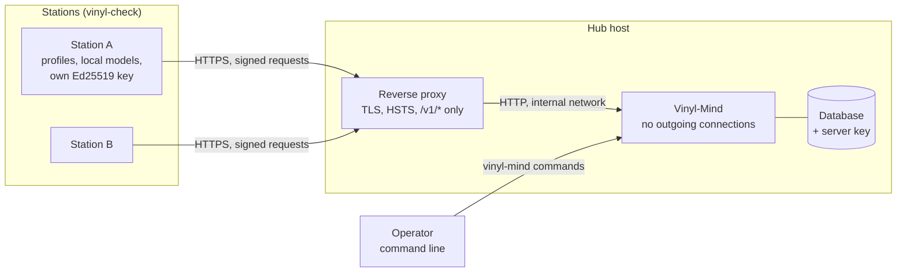
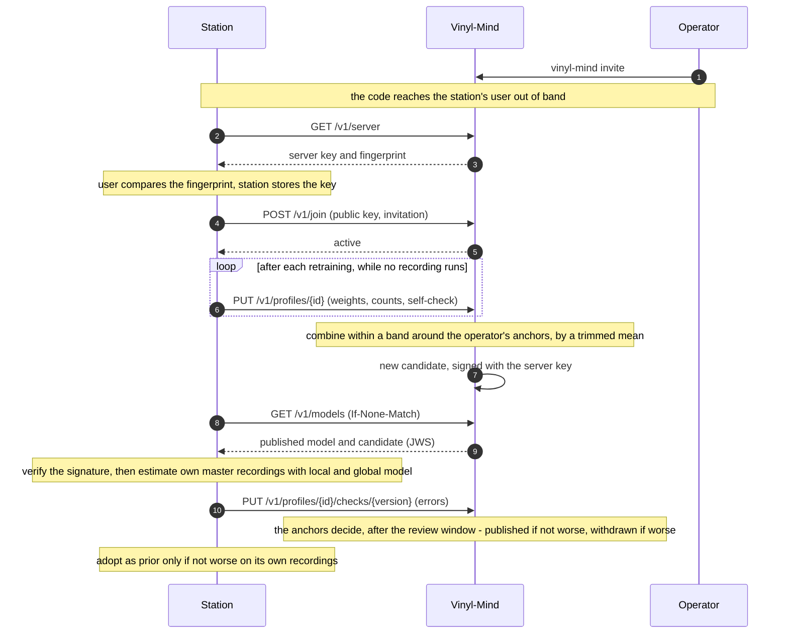
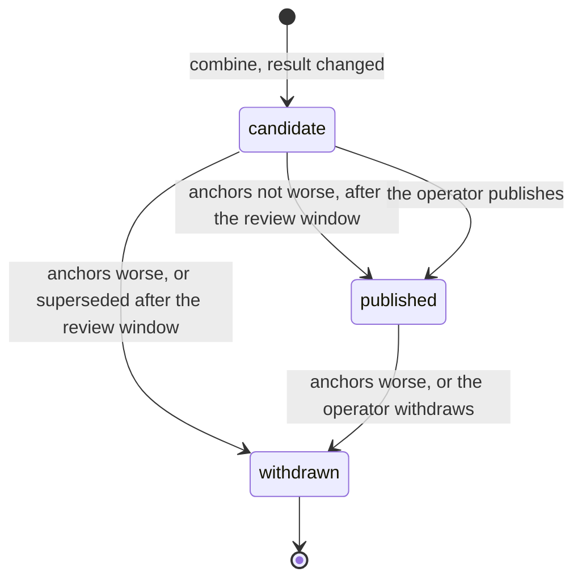

# Overview

How the parts fit together. The details are in the other documents; this page is the map.

## Who talks to whom

- Stations always open the connection; the hub never reaches into a station's network.
- Every request is signed by the station's key, every model by the server key (`spec/signing.md`). TLS at the
  proxy protects the connection on top.
- The hub needs no way to the internet. Everything that changes it (invitations, approving, revoking, publishing,
  withdrawing) is a command on the host, not an endpoint.

## From joining to using a model

## The life of a global model

A published model stays published when a newer one is published; stations take the one published last. When
that one is withdrawn, nothing takes its place until the operator publishes a model: stations fall back to their
own.

## Where to read on

| Question | Document |
|---|---|
| What exactly does a station send and receive? | [api.md](api.md), [spec/](../spec/README.md) |
| How are contributions combined, and why that way? | [aggregation.md](aggregation.md) |
| What protects the models and the stations? | [security.md](security.md) |
| What is stored, and for how long? | [privacy.md](privacy.md) |
| How do I run a hub? | [operations.md](operations.md) |
| What does vinyl-check need to take part? | [station-side.md](station-side.md) |
